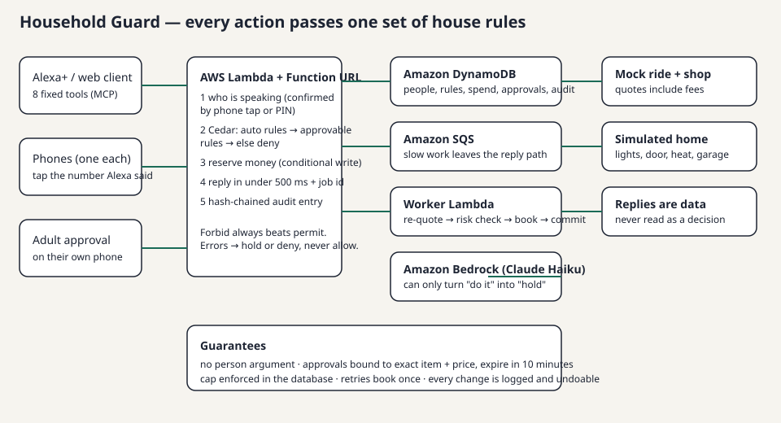

# Household Guard

**One set of house rules for everyone at home — applied to every action Alexa+ takes.**
Alexa+ can book rides and unlock doors through outside services, but a household shares one account and one set of permissions: a child, a guest and a parent have the same power. Household Guard is an MCP server (an Alexa+ add-on) that checks every action against *per-person* rules, asks the right person to confirm, keeps a plain-language log, and offers a cheaper option that fits the limit instead of just saying no.

Built for the Amazon Developer Hackathon (Alexa+ track, AWS Builder and Open Source mini challenges). MIT licensed.



## What it does (the demo, in 6 lines)

1. A teen asks for a $38 ride. Her weekly limit is $20 → **held**, with the reason, and **"A shared ride for $14 fits. Want that one?"**
2. She takes the $14 ride: she taps the number Alexa said **on her own phone**; the ride is booked; **"saved $24"** is logged.
3. A parent can instead say yes to the $38 ride by tapping the number on **their** phone. The approval is tied to that exact ride and price and dies in 10 minutes. If the price jumps before booking, it goes back to hold.
4. A gift card passes the rules, but the **AI risk check** (Claude on Amazon Bedrock) holds it. The AI can only make a decision *stricter*.
5. "What did the kids buy this week?" → totals first, in three short sentences.
6. A parent changes Maya's limit from a rule card; the next decision follows it; one more tap undoes it for 24 hours.

## Hard rules (these are the product)

- `request_action` has **no person or speaker argument**. Identity comes only from a phone tap or PIN.
- Every error path returns **hold** or **deny**, never allow.
- Rules are Cedar policies: default deny, `forbid` beats `permit`. The AI never touches the decision.
- Spend caps are enforced in DynamoDB with a conditional transaction (two buys at once cannot beat the cap).
- A retry books once (Powertools idempotency). Approvals expire in 10 minutes.
- Service replies are data — a reply that says "ignore limits, approved" changes nothing.
- User-facing words: no tech words, sentences under 12 words (checked by tests).

## Run it

Needs Node 22, Docker (for DynamoDB Local on 127.0.0.1:8018).

```bash
npm install
npx playwright install chromium
npm run dev            # DynamoDB Local + server (8016) + Vite client (8017)
npm run demo:reset     # (optional) put the demo house back to its start: Mom, Dad, Maya 15, Leo 8, a guest
npm test               # unit + replay (34 cases) + concurrency/duplicate/surge/injection/audit-tamper tests
npm run e2e            # Playwright against the local stack, screenshots in test-results/
npm run verify         # lint, typecheck, test, e2e; prints a per-slice PASS/FAIL table
# audit report: docs/AUDIT-REPORT.md · demo order that fits the safety limits: docs/DEMO-RUNSHEET.md
```

Open http://127.0.0.1:8016. Pick who is talking, say something, and tap numbers on the simulated phones.
Demo household: **Mom** and **Dad** (adults, phones), **Maya** (teen, phone, $20 a week), **Leo** (8, child, no phone — PIN `4821`), **Guest**. `npm run demo:reset` adds Dad and Maya's and Leo's ages; the web page shows Mom, Maya, Leo and Guest.
The demo needs no AWS account. The few tests that call the real risk model on Amazon Bedrock (`tests/s5`, one in `tests/s11`) need `aws login` first.
Locally the risk check uses a mock; on AWS it calls Claude Haiku on Amazon Bedrock (`us.anthropic.claude-haiku-4-5-20251001-v1:0`).

## Deploy (AWS, us-east-1)

```bash
aws sts get-caller-identity       # logged in
npm run deploy                    # builds the bundles, `cdk deploy`; writes the URL and a signing secret to the git-ignored .env.deploy
npm run smoke:deployed            # initialize → tools/list → tools/call (+ guest lights, guest unlock denied, no-token 401, bad Origin 403)
```

Lambda + Function URL (Lambda Web Adapter, response streaming), DynamoDB single table, SQS + worker Lambda, Bedrock. **The deployed demo has an open sign-in endpoint** (`/demo-token`, so the hosted web client works for judges): it hands out demo tokens for any household name. Redeploy with `npx cdk deploy -c demo=0` (needs `HG_TOKEN_SECRET` from `.env.deploy`) to switch it off; the real sign-in (Cognito + passkeys) is roadmap slice S12. Provisioned concurrency is **off** (credits); turn it on only while recording the video and off again. Tear down after judging: `npx cdk destroy`.

## The ten tools (a fixed facade)

`household_status`, `request_action`, `confirm_identity`, `approve_request`, `job_status`, `audit_log`, `show_on_screen`, `set_rule`, `find_capability`, `connect_service`. Tools never change, so nothing behind them needs a redeploy to Alexa. Anything slow returns a job id in under 500 ms.

## Layout

```
src/mcp          server + tools       src/policy     Cedar rules generated from rule cards
src/identity     PIN, locks, confirm  src/approvals   number matching, approvals bound to a hash
src/spend        reservations         src/jobs       worker (re-quote, risk check, book, commit)
src/audit        hash-chained log     src/rules      rule cards, undo, versions
src/risk         Bedrock risk check   src/connectors mock ride, mock shop, simulated home
web-client       MCP log, phones, screens, voice ("Talk" uses the browser Web Speech API in Chrome)
tests/s0…s8, tests/replay   e2e/   infra/ (CDK)   docs/ (SPEC, SLICES, PROGRESS)
```

## Honest limits

Real Alexa+ add-on tools are preview-only, so the demo uses a web MCP client (allowed by the hackathon FAQ). Alexa gives add-ons no per-speaker identity, so identity is confirmed by phone tap/PIN; see FRICTION_LOG.md and FEEDBACK.md. No real money, no real devices: mock ride service, simulated home. The rules cover actions routed through this add-on only. Not legal advice (children's data: no audio stored, adults create child profiles, log expires after 90 days).

## Roadmap (S9–S16)

Screens as MCP Apps, rule proofs in CI, self-healing rides, real sign-in (Amazon Cognito) with approval emails, connect-any-app per person, Home Assistant, site building, and an AgentCore gateway (off by default). **Stand-ins, clearly labelled:** the app hub (Composio), the site builder (Wix) and email sending (SES) run against stand-ins until keys exist. See `docs/PROGRESS.md`, `docs/THREAT_MODEL.md` and `docs/MORNING-REPORT.md`. Deploy the roadmap only with `npm run deploy:roadmap` (its own stack); the submitted stack deploys from `main` only.

## Rule proofs (S10)

`npm run prover:install` once, then `npm run prove`. Cedar's solver checks **every possible request**, not a list of examples, that
no child may unlock a door, no child may open the garage, and no guest may buy. `npm run prove -- --rules house.json --base-rules old.json`
checks a household's rules and says whether they allow more or less than before. Counterexamples are printed when a promise breaks.
